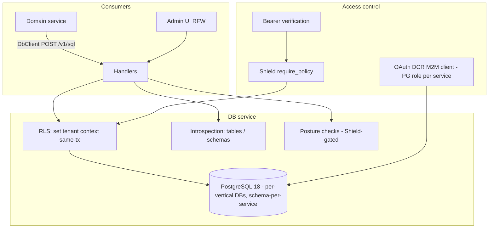

# Design Doc: Sentin8:DB — SQL Execution & Data Service

## 1. Summary

Sentin8:DB is the platform's structured-persistence gateway. All domain
services execute SQL through it (parameterized statements, table and
schema introspection, posture checks) instead of holding PostgreSQL
connections directly. Every query runs under RLS with the tenant
context set from the caller's token; direct PostgreSQL access from
domain services is prohibited.

## 2. Motivation

- **One persistence plane.** Services must not embed connection pools
  to the shared database (pool exhaustion across ~20 services, per-
  service credential sprawl). Sentin8:DB centralizes connectivity,
  credentials, and the PostgreSQL OAuth (DCR-registered M2M) path.
- **RLS is the tenant backstop.** Every tenant table is
  `ENABLE`+`FORCE ROW LEVEL SECURITY`d; the DB service sets the tenant
  context transaction-local on the same connection as the query — the
  single most important invariant in the platform's data layer.
- **Introspection as an API.** Tables/schemas listing and health
  posture (replication lag, bloat, connections) are operational
  surfaces, Shield-gated.
- **Per-service roles.** Each service's M2M workload maps to a
  PostgreSQL role in its own vertical database with its own grants —
  never a shared superuser.

## 3. Architecture & High-Level Design

- **SQL execution** — parameterized statements via `POST /v1/sql` with
  bindings; results are JSON-shaped (rows + row count).
- **Tenant context** — the caller's `env_id` is set via
  `sentin8_set_tenant_context` inside the same explicit transaction as
  every statement (transaction-local; split batches lose context and
  RLS then filters everything).
- **PostgreSQL OAuth** — the service connects as its DCR-registered
  M2M identity; the platform superuser is DDL-only.
- **Admin surface** — RFW pages for schemas, tables, posture;
  Shield-gated with the enforced scope-mirror set.

## 4. Key Traits and Data Structures

- **`DbConfig`** — database URL, pool cap (`sentin8_config::pg_pool`
  — max 3, env-overridable), auth issuer wiring.
- **`SqlRequest` / `SqlResponse`** — the execution contract: statement
  text + positional bindings → rows (as JSON) + affected count.
- **RLS helpers** — `sentin8_set_tenant_context` invocation wrapped in
  caller-managed transactions; never on a bare pool acquire.
- **Introspection rows** — table/schema metadata (columns, types)
  surfaced for the admin UI and migrations.

## 5. Rationale, Trade-offs, and Alternatives

- **A gateway service over per-service pools.** One credential owner,
  one pool cap enforcement point, one audit surface. The cost is an
  HTTP hop per query — negligible against the isolation win, and
  HTTP/2 multiplexing keeps it cheap.
- **Transaction-local context, enforced by pattern.** `set_config(…,
  true)` evaporates at statement end; a context set outside the
  caller's transaction silently filters all rows (the failure signature
  was "0 rows" from resolvers and denied outbox INSERTs). The rule:
  begin → set context → statements → commit, all on one connection.
- **Explicit `WHERE env_id = $N` everywhere.** RLS is the backstop;
  explicit clauses are the primary filter and survive policy
  misconfiguration. Both layers, always.
- **No BYPASSRLS anywhere.** The relay exceptions are retired —
  producers write their own outbox under their own service role;
  cross-schema reads are explicit, declared grants (never blanket).
- **PostgreSQL 18+ enforced.** The OAuth token hook (database OAuth via
  DCR) requires PG 18; the service refuses older servers at boot.
- **Parameterized-only SQL.** Bindings cannot interpolate; a stringly-
  concatenated statement would reintroduce injection into a service
  whose entire job is running caller SQL.
- **Posture as a first-class surface.** Connection saturation, replica
  lag, and bloat are the operational failure modes; surfacing them via
  the admin API (Shield-gated) beats psql archaeology during incidents.
- **Rejected: per-service read-replica pools.** The DB service already
  routes; duplicating routing per service forks the credential and
  context logic.
- **Rejected: stored procedures as the API.** They hide SQL from
  review and migrate poorly; explicit parameterized statements from
  services keep the surface visible.

## 6. Internal Implementation & Invariants (Private Design)

- **Invariants:**
  - Only Sentin8:DB (and migrations via the CLI) touch PostgreSQL
    directly; domain services use the `DbClient`.
  - Every tenant statement: same connection, context set inside the
    explicit transaction, statement inside that transaction.
  - The service's role carries NO BYPASSRLS; RLS is FORCEd on tenant
    tables.
  - Bindings are positional and typed; no client-side string building.
  - Pool is capped (3, `SENTIN8_PG_POOL_MAX` overridable) — a runaway
    consumer cannot exhaust the shared instance.
  - Schema listing uses qualified names — unqualified cross-schema
    references fail (search_path is service-scoped).
- **Boot (shell-owned).** The shell owns the listener stack; DB builds
  its capped pool, enforces PG18, consumes the single Shield engine,
  and mounts the admin + SQL routes.
- **Error mapping.** PostgreSQL errors map to typed errors
  (`unique_violation`, RLS denials) so callers can branch without
  string matching.

## 7. Unresolved Questions / Future Designs

- Read-replica routing is deferred: the DB service is a thin, capped pool over
  the platform's primary; replicas arrive with multi-node deployment as a
  pool-level routing option (`read_replica` pool in
  `sentin8_config::pg_pool`), not a per-statement contract — a non-goal until
  then.
- Statement timeouts are set per acquired connection from the request class
  (interactive 5s, batch 60s, default 5s) — one `SET LOCAL` in the tenant
  transaction; no schema or API change.
- Row-level audit includes the affected row ids in the existing audit emit's
  payload (the CRUD handlers know them) — correlation falls out of the audit
  envelope's `resource` + `resource_id` fields; no new audit surface.

---

**Design attribution:** sentin8:db and its underlying concepts were designed by Hamid Jahanzad <Hamid@Jahanzad.com>.
